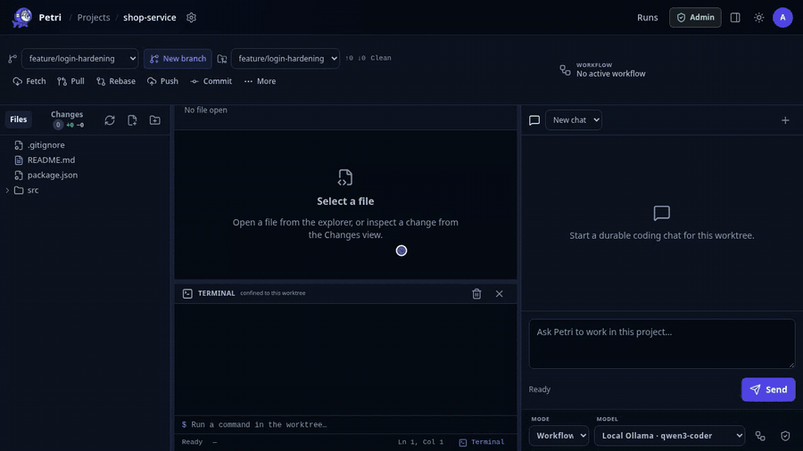

<p align="center">
  
</p>

# Petri

**Petri is a self-hosted agentic coding harness, multi-agent orchestrator and agentic development
environment.**

- **Harness:** a controlled runtime around the model. Every model response, tool call and tool
  result is persisted. File changes and test runs are *proposals* that need explicit approval, run
  inside disposable Git worktrees and rootless sandboxes, and are bounded by budgets, leases and
  server-enforced tool allowlists.
- **Orchestrator:** a deterministic state machine drives isolated Orchestrator, Planner, Implementer
  and Reviewer agents through gated stages (plan → approval → implement → review → final gate).
  Model output is validated evidence; it can never change workflow state on its own.
- **Development environment:** a browser workspace with a file explorer, Monaco editor, Git
  controls, diffs and a durable chat, so you can plan, review, edit and ship in one place.

Petri is written in Java 25 on Spring Boot, runs on a single node with an embedded H2 database or on
PostgreSQL, and works with OpenAI, LiteLLM, Ollama and any OpenAI-compatible endpoint.

<p align="center">
  
</p>

<p align="center"><sub>
  One gated workflow, start to finish: plan, approval, implementation, a rework loop at the evidence
  gate, and the Petri net verifying each acceptance criterion against real changes.
</sub></p>

## Features

### Agentic orchestration

- **Gated multi-agent workflows** with four isolated roles, each with its own provider, model,
  budgets, attempt limit and prompt addendum, snapshotted when a task is submitted.
- **Planner questions** (single-select, multi-select, free text) and **revision-bound plan approval**
  with warnings, revision requests and guidance at safe boundaries.
- **Deterministic evidence gates:** workflow-only task diffs, final file hashes, test results and
  structured reviewer findings feed the implementation and final gates.
- **Automatic application** of approved patches and sandboxed tests, scoped to the approved plan and
  to the workflow's own worktree.
- **Final-gate summary** written by the orchestrator, and user approval to finish when only executed
  tests are missing.
- **Fail-closed holds** with automatic stopping after exhausted attempts, plus a manual **Retry**
  that always grants a fresh attempt budget.
- **Queueing and cancellation:** follow-up tasks queue in order; cancelling preserves applied
  changes and releases the worktree at a safe boundary.
- **Direct mode** for plain single-agent chats with optional per-chat auto-approval.
- **Skills:** lazy-loaded, operator-controlled `SKILL.md` workflows that add guidance but never
  capabilities.

### Development environment

- **Workspace UI:** lazy file explorer, Monaco tabs with persistent drafts, optimistic saves and
  conflict-safe reloads, side-by-side or inline diffs.
- **Terminal panel** below the editor; agents get an approval-gated `run_command` tool (per-project
  auto-approve) whose commands run as an OS-level user confined to the worktree.
- **Live workflow panel** shown as a Petri net with per-goal verification, status, attempts and cancel; it stays on *Done* until the
  next workflow starts.
- **Streaming chat** with timestamped tool calls, agent messages and artifacts, reconnect recovery
  and a "guide active task" toggle to steer the running task or queue a new one.
- **Git bar and Changes panel:** branches, worktrees, fetch, pull (fast-forward), rebase, commit,
  push, force-with-lease, and stage / unstage / **revert** per file, section or all changes.
- **Review tray** for patch and test proposals with inline diffs.

### Repository and Git isolation

- Controlled bare mirror per project and **branch-bound disposable worktrees**.
- Personal and global **GitHub, GitLab and Forgejo** connections (PAT/OAuth) with live repository
  catalogs and bulk import, or simple per-project HTTPS credentials.
- Git runs without a shell, with prompts disabled, global/system config ignored, bounded and
  redacted output, and credentials supplied only through a temporary owner-only askpass helper.
- Dirty-state baselines so workflow evidence only includes what the workflow touched.

### Models

- OpenAI Responses API, LiteLLM Responses API, Ollama and generic OpenAI-compatible Chat
  Completions.
- Per-provider base URL, model, output budget and optional encrypted API key; per-task overrides,
  reasoning effort and verbosity, token streaming and context-window summaries.

### Tools and testing

- Native tools: `list_files`, `read_file`, `search_files`, `create_patch`, `create_file`,
  `show_diff`, `run_tests`, `install_packages`, `run_command`, `list_skills`, `load_skill`.
- **Approval-gated Alpine package installs:** agents request tools (`jq`, `python3`, `nodejs`, …)
  with a reason; installs run only after approval (or per-project auto-approve) into an unprivileged
  toolchain prefix. Models are told they run on Alpine and how installs work.
- Path, symlink and `.git` protections; SHA-256 guarded edits that record `CONFLICT` instead of
  overwriting concurrent changes.
- Tests run only as fixed Maven/Gradle commands, by default in **rootless Podman** with an immutable root
  filesystem, dropped capabilities, resource limits and project-isolated caches. An opt-in `local`
  executor (the Alpine image default) runs them in Petri's own container instead.

### Platform and security

- Local administrator login and optional **OIDC** with verified-email account linking.
- Owner-scoped projects and API keys; administrator-only global providers, models and sandbox
  profiles.
- **AES-256-GCM** encryption of Git and model secrets; secrets are never rendered back.
- Audit log, persistent run events with JSON replay and Server-Sent Events, health and Prometheus
  endpoints.
- Flyway-managed schema, durable runs with execution leases and restart recovery.
- REST API under `/api/v1/**` for runs, worktrees, events and tools.

## Quick start

Requirements: JDK 25 and Maven 3.9+ (the wrapper is included). Rootless Podman is needed only to run
tests.

```bash
./mvnw test
./mvnw spring-boot:run
```

Open <http://localhost:8080> and sign in with `admin@petri.local` / `admin` for local evaluation.
Set `PETRI_ADMIN_EMAIL` and `PETRI_ADMIN_PASSWORD` before exposing the service beyond localhost.

Then:

1. Add a model provider at `/model-settings` (administrators), then add your API key under
   **Model providers** if the provider needs one.
2. Register a repository at `/projects` (or connect a Git account at `/git-accounts`) and synchronize
   its mirror.
3. Open the project workspace, pick or create a branch, and start a chat in **Workflow** mode.

See [Getting started](docs/getting-started.md) for the full first-task walkthrough.

## Run with Docker or Kubernetes

Images are published to GHCR on every merge to `main`, built on Alpine (JDK 25), signed with
Cosign and shipped with SLSA provenance and a CycloneDX SBOM:

```bash
docker run --rm -p 8080:8080 -v petri-data:/app/data ghcr.io/wenisch-tech/petri:latest
```

The Helm chart lives in [`charts/petri`](charts/petri) and is published to the
[Wenisch Tech Helm repository](https://github.com/wenisch-tech/helm-charts):

```bash
helm repo add wenisch-tech https://charts.wenisch.tech
helm install petri wenisch-tech/petri -n petri --create-namespace
```


| Variable | Purpose |
| --- | --- |
| `PETRI_ADMIN_EMAIL`, `PETRI_ADMIN_PASSWORD` | Initial administrator account. |
| `PETRI_SECRETS_MASTER_KEY` / `PETRI_SECRETS_MASTER_KEY_FILE` | Base64 32-byte key, or key file location (generated at `./data/petri-master.key` if unset). **Back it up**; losing it makes stored secrets unrecoverable. |
| `PETRI_WORKSPACE_ROOT` | Mirrors and worktrees (default `./data/workspaces`). |
| `PETRI_SKILLS_ROOT` | Skill directory (default `./skills`). |
| `SPRING_DATASOURCE_*` | Switch from embedded H2 (`./data`) to PostgreSQL. |

The full reference, including limits, timeouts and OIDC setup, is in
[Configuration](docs/configuration.md).

## Documentation

| Topic | Document |
| --- | --- |
| Overview and index | [docs/README.md](docs/README.md) |
| Run Petri, first task | [Getting started](docs/getting-started.md) |
| What exists today | [Implemented features](docs/implemented-features.md) |
| Environment and OIDC | [Configuration](docs/configuration.md) |
| Providers and endpoints | [Model providers](docs/model-providers.md) |
| Mirrors, branches, worktrees | [Git workspaces](docs/git-workspaces.md) |
| GitHub / GitLab / Forgejo | [Git provider accounts](docs/git-provider-accounts.md) |
| Model loop and approvals | [Agent workflow](docs/agent-workflow.md) |
| Multi-agent gates | [Gated orchestration](docs/gated-orchestration.md) |
| Test isolation | [Test sandboxes](docs/test-sandboxes.md) |
| API reference | [HTTP API](docs/http-api.md) |
| Trust boundaries | [Security model](docs/security.md) |
| Build and project layout | [Development](docs/development.md) |
| Kubernetes | [Helm chart](charts/petri/README.md) · [charts.wenisch.tech](https://github.com/wenisch-tech/helm-charts) |

## License

Petri is licensed under the GNU Affero General Public License v3.0.
